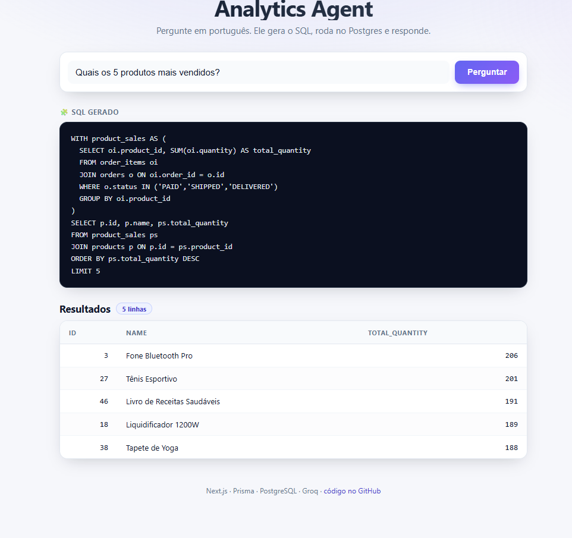

# Analytics Agent — Text-to-SQL em linguagem natural

Agente de analytics que responde perguntas em **português** sobre dados de
e-commerce. O usuário pergunta (ex: *"quais os 5 produtos mais vendidos?"*), o
sistema **gera SQL**, roda no PostgreSQL em modo **somente-leitura** e devolve a
tabela de resultados — ou recusa, quando o dado não existe no schema.



> _O arquivo `docs/screenshot.png` é um placeholder — coloque aqui um print ou
> GIF do app rodando (input da pergunta + SQL gerado + tabela de resultados)._

---

## Stack

- **Next.js 15** (App Router) + **TypeScript**
- **Prisma** ORM + **PostgreSQL 16** (local via Docker)
- **Groq** como provedor de LLM, via SDK da OpenAI (compatível) — modelos
  `openai/gpt-oss-120b` / `openai/gpt-oss-20b`
- **Embeddings locais** com `@xenova/transformers` (all-MiniLM-L6-v2) para o
  modo RAG — roda no Node, sem custo de API _(opcional, desligado por padrão)_

---

## Como rodar local

Pré-requisitos: Node 18+, Docker, e uma API key da [Groq](https://console.groq.com).

```bash
# 1. Dependências
npm install

# 2. Variáveis de ambiente
cp .env.example .env
#   edite .env e coloque sua LLM_API_KEY da Groq

# 3. Banco (Postgres no Docker)
npm run db:up        # docker compose up -d

# 4. Schema + dados
npm run db:migrate   # aplica as migrations (prisma migrate deploy em prod)
npm run db:seed      # popula ~30 tabelas com dados realistas

# 5. App
npm run dev          # http://localhost:3000
```

Scripts úteis: `npm run db:studio` (Prisma Studio), `npm run db:reset`
(recria e re-semeia), `npm run db:down` (derruba o container).

### Variáveis de ambiente (`.env.example`)

| Variável | Para quê |
|---|---|
| `DATABASE_URL` | conexão do Prisma com o Postgres |
| `POSTGRES_PORT` | _(opcional)_ porta do container, se a 5432 estiver ocupada |
| `LLM_BASE_URL` | endpoint da Groq (`https://api.groq.com/openai/v1`) |
| `LLM_API_KEY` | sua chave da Groq |
| `LLM_MODEL` | modelo (ex: `openai/gpt-oss-120b`) |
| `USE_RAG` | `false` (padrão) = schema inteiro no prompt; `true` = RAG |

> Se a porta 5432 já estiver em uso, rode `POSTGRES_PORT=5434 npm run db:up` e
> ajuste a porta na `DATABASE_URL`.

---

## Arquitetura

Fluxo de uma pergunta (`POST /api/ask`):

```
pergunta (pt-br)
   │
   ▼
[1] geração de SQL (lib/llm.ts)
   • system prompt = schema em texto + regras de contrato
   • LLM (Groq) responde JSON { sql | null, motivo?, premissa? }
   │
   ▼
[2] guard read-only (lib/guard.ts)
   • aceita SELECT e WITH ... SELECT
   • bloqueia INSERT/UPDATE/DELETE/DROP/ALTER/... e múltiplos comandos
   • injeta LIMIT 500 se o SELECT final não tiver LIMIT
   │
   ▼
[3] execução (lib/runQuery.ts)
   • transação com SET LOCAL transaction_read_only = on
   •                SET LOCAL statement_timeout = '5s'
   • prisma.$queryRawUnsafe (SQL dinâmico)
   │
   ▼
[4] serialização (lib/serialize.ts)  → BigInt / Decimal viram number
   │
   ▼
resposta JSON → UI (app/page.tsx)
```

### Contrato de 3 canais

O LLM responde sempre em JSON, em um de três formatos:

| Canal | Formato | Quando |
|---|---|---|
| **SQL** | `{ "sql": "SELECT ..." }` | pergunta clara e respondível |
| **Recusa** | `{ "sql": null, "motivo": "..." }` | o dado **não existe** no schema (ex: "canal de marketing", "satisfação do SAC") — o modelo é instruído a **não inventar** coluna |
| **Premissa** | `{ "sql": "...", "premissa": "..." }` | pergunta **ambígua** mas respondível (ex: "melhor produto" = receita? unidades? lucro?) — escolhe a leitura mais comum e **avisa** |

A UI mostra a tabela, ou a mensagem de recusa, ou a nota "Interpretei como: ..."
acima dos resultados.

### Segurança

Defesa em profundidade: o **guard** barra qualquer coisa que não seja leitura
antes de executar, e a **transação read-only + timeout** garante que, mesmo que
algo passe, o banco não é alterado e consultas longas são abortadas em 5s.

---

## Avaliação e o que aprendi

Há uma suíte de **30 perguntas** em [`evals/questions.json`](evals/questions.json)
cobrindo: contagens simples, regras de negócio não ditas (faturamento exclui
cancelados), ambiguidade, multi-passo (crescimento mês a mês, % por categoria),
tabelas/colunas **confundíveis** de propósito (`coupons` vs `promotions` vs
`discounts`; `price`/`cost`/`list_price`/`sale_price`; entrega vs cobrança;
`payments` vs `refunds`) e armadilhas de alucinação (dados que não existem). O
runner [`evals/run.ts`](evals/run.ts) roda o pipeline de ponta a ponta e mede
`prompt_tokens`.

### Baseline — schema inteiro no prompt (padrão do app)

Schema de ~30 tabelas descrito por completo no system prompt:

| Modelo | ✅ ok | 🚫 recusa | ❌ erro | prompt_tokens/pergunta |
|---|---|---|---|---|
| gpt-oss-120b | **27** | 3 | **0** | **~1878** |
| gpt-oss-20b | **27** | 3 | **0** | **~1878** |

As 3 recusas são as corretas (CAC, canal de marketing, satisfação do SAC — não
existem no schema). Zero SQL quebrado, e **todas as confundíveis** foram
resolvidas na tabela certa.

### RAG — recupera só os chunks relevantes

Em vez do schema inteiro, embeda a pergunta e recupera **top-6 tabelas + top-4
regras + top-3 exemplos** (embeddings locais, cosseno):

| Modelo | ✅ ok | 🚫 recusa | ❌ erro | prompt_tokens/pergunta |
|---|---|---|---|---|
| gpt-oss-120b | **22** | 8 | 0 | **~1202 (−36%)** |
| gpt-oss-20b | **19** | 11 | 0 | **~1202 (−36%)** |

### Conclusão honesta

Nesta escala (**30 tabelas**), **o RAG regride o acerto**: o corte em top-6
tabelas às vezes **não traz a tabela certa** (ex: perguntar de "fornecedores"
sem recuperar `suppliers`, ou "cidades de entrega" sem `addresses`), e o modelo
— corretamente, dado o contexto que recebeu — **recusa achando que o dado não
existe**. São **recusas falsas por miss de retrieval**, não erros de SQL nem
escolha de tabela errada. O ganho de ~36% em tokens **não compensa** perder 5 a
8 respostas certas.

O valor do RAG aparece quando o schema é **grande demais para caber no prompt**
(centenas de tabelas) — aí "tudo no prompt" deixa de ser opção e recuperar bem
passa a ser o único caminho. Com 30 tabelas, o schema inteiro ainda cabe
folgado (~1878 tokens), então **o app roda no baseline** (`USE_RAG=false`), que
é o config preciso (27/3/0).

O código de RAG ([`lib/rag.ts`](lib/rag.ts), [`lib/tableChunks.ts`](lib/tableChunks.ts),
[`lib/examples.ts`](lib/examples.ts)) fica no repositório, atrás do toggle
`USE_RAG`, como demonstração e ponto de partida para schemas maiores. Os
exemplos few-shot são **disjuntos** da suíte de avaliação (não se ensina o
teste). Relatórios completos em [`evals/`](evals/).

Próximos passos naturais para o RAG valer a pena em escala: expansão por FK
(recuperar `order_items` puxa `orders`), retrieval híbrido (BM25 + embedding) e
uma lista barata de nomes de tabela sempre no prompt.

---

## Estrutura

```
app/
  page.tsx            UI (input, SQL gerado, tabela/recusa/premissa)
  api/ask/route.ts    endpoint POST /api/ask
lib/
  llm.ts              geração de SQL + contrato de 3 canais (+ toggle RAG)
  schema.ts           schema em texto (baseline "tudo no prompt")
  guard.ts            guard read-only
  runQuery.ts         execução em transação read-only + timeout
  serialize.ts        BigInt/Decimal → JSON
  rag.ts              índice de embeddings + recuperação (modo RAG)
  tableChunks.ts      1 chunk por tabela
  glossary.ts         métricas/regras de negócio
  examples.ts         few-shot pergunta→SQL (disjunto do eval)
prisma/
  schema.prisma       ~30 tabelas, snake_case
  seed.ts             dados realistas
evals/
  questions.json      30 perguntas
  run.ts              runner de diagnóstico
  results-*.md        relatórios (baseline e RAG, por modelo)
```
